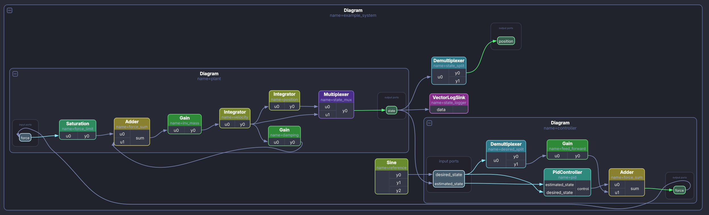
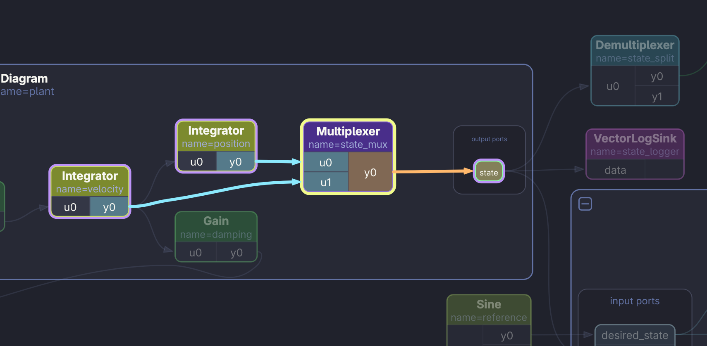
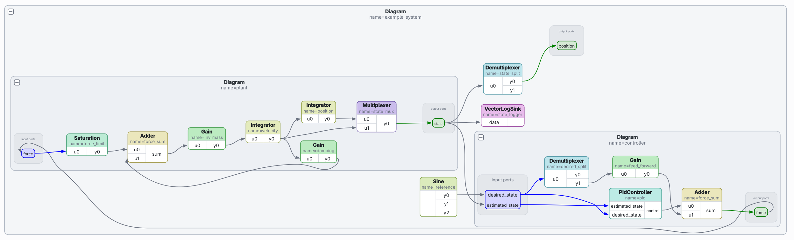

# Drake Diagram Viewer

Interactive viewer for [Drake](https://drake.mit.edu) system diagrams. It takes the static Graphviz SVG that Drake exports and rebuilds it as a live, explorable scene: click a block to trace its connections, fold sub-diagrams, and group blocks.

Large Drake diagrams quickly turn into a wall of boxes and wires. This tool makes them navigable.

> **Note:** This project is fully vibe coded and is delivered as-is. See [Disclaimer](#disclaimer).



## Features

- **Click to trace**: selecting a block highlights all its connections (orange = outgoing, blue = incoming, green = between selected blocks). Connected port rows light up and everything unrelated is dimmed.
- **Drag blocks**: arrows follow, diagram boxes resize to fit. Dragging a diagram's title or border moves the whole sub-diagram.
- **Fold / unfold sub-diagrams**: collapse a sub-diagram into a single block that lists its input and output ports. Arrows re-attach to the matching port rows.
- **Groups**: group several blocks, move them as one, rename the group.
- **Search**: find blocks by name or type; diagrams hiding a match are unfolded automatically.
- **Save layout**: positions, groups and folds are stored next to the SVG and restored on the next start.
- **Auto-reload**: when the SVG is regenerated (e.g. by your own script), the viewer reloads it and keeps your layout. New blocks are placed next to the blocks they sit beside.
- **Export**: render to PNG or SVG, also headless from the command line.
- **Dark mode** by default, toggleable and remembered.

## Screenshots

**Click a block to trace its connections.** The selected block gets a yellow outline, outgoing arrows turn orange, incoming arrows turn blue, and everything unrelated is dimmed.



**Light mode** is available too (`Ctrl+Shift+D`).



## Installation

Requires Python 3.9+ and PySide6 (PyQt6 also works, but PySide6 is the recommended backend).

```bash
git clone https://github.com/<your-username>/<repo-name>.git
cd <repo-name>
pip install -r requirements.txt
```

## Usage

### 1. Export your diagram from Drake

```python
import subprocess

svg = subprocess.run(
    ["dot", "-Tsvg"],
    input=diagram.GetGraphvizString(max_depth=None),
    capture_output=True, text=True, check=True,
).stdout
open("system_diagram.svg", "w").write(svg)
```

(Requires Graphviz's `dot` on your `PATH`.)

### 2. Open it

```bash
python drake_diagram_viewer.py system_diagram.svg
```

### Headless export

```bash
python drake_diagram_viewer.py system_diagram.svg --export out.png
python drake_diagram_viewer.py system_diagram.svg --collapse --export out.png
```

Other options: `--layout FILE`, `--theme dark|light`, `--scale N`.

## Controls

| Action | Effect |
| --- | --- |
| Click block | Highlight block and all its arrows |
| Drag block | Move it; arrows follow |
| Drag diagram title/border | Move the whole sub-diagram |
| `[-]` / `[+]` or double-click | Fold / unfold a sub-diagram |
| Drag on empty space | Rubber-band select |
| Ctrl/Shift + click | Add to selection |
| Alt + click | Select one block, ignoring its group |
| `Ctrl+G` / `Ctrl+Shift+G` | Group / ungroup selection |
| `Ctrl+K` / `Ctrl+Shift+K` | Fold all / unfold all |
| `Ctrl+F` | Search blocks |
| `D` | Toggle dimming of unrelated items |
| `F` | Fit to window |
| Right/middle drag, wheel | Pan, zoom |
| `Ctrl+S` | Save layout |
| `Ctrl+E` | Export PNG / SVG |
| `F5` | Force reload |
| `Ctrl+Shift+D` | Dark / light mode |
| `F1` | Show controls |

## Optional integrations

These helpers are independent of the viewer itself.

### `drake_probe.py`: live port values

Replaces `sim.AdvanceTo(np.inf)` while debugging. After every chunk of simulated time it evaluates the input and output ports of every system (recursively) and writes a compact summary to `~/.cache/drake_diagram_viewer/<name>.values.json` (or under `$XDG_CACHE_HOME`).

```python
from drake_probe import run_debug

sim = Simulator(diagram, context)
sim.Initialize()
run_debug(sim, diagram, "system_diagram")   # name = stem of your SVG
```

Useful options: `period` (simulated seconds between snapshots), `skip` (systems whose ports must not be evaluated, e.g. a camera), `end_time`.

### `integrations/nvim/drake_cursor.lua`: editor link

A Neovim plugin that writes the word under the cursor (in Python files) to `~/.cache/drake_diagram_viewer/nvim_cursor.json`, so the viewer can select the block with that name. Toggle with `:DrakeCursorToggle`.

It is written for [AstroNvim](https://astronvim.com) (it uses `AstroNvim/astrocore` options). Copy it to `~/.config/nvim/lua/plugins/`. For other Neovim setups, adapt the autocmd and command registration.

## How it works

The SVG is parsed into blocks (systems), arrows (connections) and diagram boxes (clusters), then rebuilt as a Qt `QGraphicsScene`. Blocks get stable signatures (enclosing diagram names + block type + block name), so layouts survive regenerated SVGs even when Graphviz changes its internal node ids.

## Limitations

- Built for the SVG layout produced by Drake's Graphviz export. Other Graphviz SVGs may not parse correctly.
- Tested on Linux (Fedora) only.

## Disclaimer

This project is **fully vibe coded**: written through conversation with an AI assistant, not through traditional hand-written software engineering. It is delivered **as-is**, with no guarantee of correctness, stability, or fitness for any purpose, and no promise of maintenance or support. Expect rough edges and bugs. Issues and pull requests are welcome, but responses may be slow or absent.

This project is not affiliated with or endorsed by the Drake project, Toyota Research Institute, or MIT.

## License

BSD 3-Clause. See [LICENSE](LICENSE).
